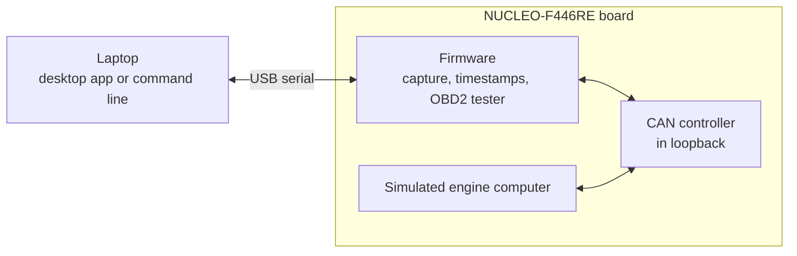

# OBD2 CAN Sniffer

[](https://github.com/ka5j/obd2-sniffer/actions/workflows/ci.yml)
[](https://ka5j.github.io/obd2-sniffer/)
[](https://github.com/ka5j/obd2-sniffer/releases/latest)

A small device for a car's diagnostic port: it listens to the conversations between the car's
computers, asks the engine computer for live data, and shows it all on a laptop. It is built from
scratch on an STM32 microcontroller, with a desktop app and a command-line tool for the laptop
side. Today it runs on the board alone, against a simulated engine computer.

> Under active development. See [Project status](#project-status) for what works today.

## The idea

A modern car has dozens of small computers (ECUs) controlling the engine, brakes, airbags and
dashboard. They talk to each other over a shared wired network called the **CAN bus**. Since 2008,
every car sold in North America exposes that network through the **OBD2 port** under the
dashboard. Mechanics plug their scan tools into the same port.

This project is a scan tool and network analyzer I am building myself:

- **Listen:** record every message on the car's network, with precise timestamps, without
  interfering with it.
- **Ask:** request standard diagnostic data from the engine computer, such as RPM, speed, coolant
  temperature, throttle position, the vehicle identification number (VIN), and check-engine
  trouble codes.
- **Show:** stream everything to a laptop, where it can be watched live, graphed, and saved.

## Highlights

- **Three ways to use it.** A desktop app, a command-line tool for the terminal, or plain typed
  commands in any serial terminal with nothing to install. Every feature works in all three.
- **Keeps up with a busy network.** Each message is captured the moment it arrives, timestamped
  to the microsecond, numbered, and moved to the laptop in a compact, error-checked format.
  Measured on the board: 100,000 messages in a row at 100% network load, none lost. When traffic
  outgrows the USB link, every dropped message is counted and reported, never silently lost.
- **Speaks the car's diagnostic language.** The board asks for live engine data, trouble codes
  and the VIN using OBD2 and its multi-frame transport (ISO-TP), written from scratch. Measured:
  838 requests in 9 seconds, every one answered.
- **Testable without a car.** The board plays the car too: a simulated engine computer answers
  the diagnostic requests through the real CAN controller in loopback. The laptop tool also has
  a software simulator of the whole board, so it runs with no hardware at all.
- **Recovers from crashes and says why.** A watchdog restarts the board if the program ever
  stops responding, and a crash handler records the fault type and code address, then reports
  them after the restart.
- **Careful by default.** CAN is off at start-up, and the board only transmits in loopback mode,
  where nothing leaves the chip.
- **Tested to safety-critical standards.** The core logic is unit-tested to 100% MC/DC coverage,
  the coverage standard used for flight-control and automotive safety software, and all C code
  follows the **MISRA C:2012** coding rules used in the automotive industry, with every exception
  documented. Every change is built, tested and checked automatically before it can be merged.
  Results are published as a [live quality report](https://ka5j.github.io/obd2-sniffer/).

## How it works

Today the board works on its own, with no car and no extra parts:



1. The **CAN controller** runs in loopback: it receives its own messages and nothing leaves the
   chip, so the firmware can play both the diagnostic tool and the car.
2. The **firmware** captures each message, timestamps it and numbers it. Its OBD2 tester asks
   the simulated engine computer for live data, trouble codes and the VIN.
3. The **laptop software** receives the data over USB and displays it.

To connect to a real car, a CAN transceiver chip goes between the board and the car's OBD2 port.
That part is designed ([hardware.md](docs/design/hardware.md#connecting-to-a-car)) but not built
yet; see [Project status](#project-status).

## Ways to use it

| Interface | What it looks like | Good for |
|---|---|---|
| Desktop app | `obdsniff gui`: board status and controls, a console, live CAN frames, OBD2 live data | Watching live data, demos |
| Command-line tool | `obdsniff obd watch`, `obdsniff monitor`, `obdsniff can test`, `obdsniff shell`, ... | Watching and logging traffic, scripting, automated checks |
| Serial terminal | Open the board's USB serial port and type `help` | Using the device with no software installed |


Try the laptop tool without a board: `pip install -e "host[gui]"`, then `obdsniff --port sim shell`
or `obdsniff --port sim gui`. See [host/README.md](host/README.md).

## Measured on the board

| What | Result |
|---|---|
| CAN capture, 500 kbit/s at 100% load | 100,000 messages, 0 lost, 0 damaged |
| CAN overload, 1 Mbit/s at 100% load (Release build) | The bus outruns the USB link: 5,210 of 20,000 dropped, each one counted on the board and seen as a gap on the laptop. With streaming off, 0 dropped |
| Commands while the CAN bus is full | 2,693 commands as 42,129 messages arrived, none failed, no byte lost |
| OBD2 against the simulated engine computer | 838 requests in 9 s, every one answered, 0 timeouts |
| Longest CAN receive interrupt | 7 µs (10 µs with OBD2 traffic), against 238 µs between messages at full load |
| Watchdog | A stuck board restarts after 535 ms and reports why |

How each number was measured: [testing.md](docs/design/testing.md#checks-on-the-board).

## Topics touched with this project

| Area | Details |
|---|---|
| Embedded C | Bare-metal firmware on an Arm Cortex-M4, no operating system |
| Microcontroller peripherals | Clocks, UART serial, DMA, timers, interrupts, watchdog, CAN controller |
| Automotive protocols | CAN, OBD2 (SAE J1979), ISO-TP multi-frame transport |
| Reliability | Watchdog, crash capture and reporting, interrupt priorities set by deadline, flow control |
| Python | Desktop app (PySide6), command-line tool, serial communication, board simulator |
| Code quality | MISRA C:2012 compliance with documented deviations, static analysis (cppcheck), worst-case stack analysis |
| Testing and tooling | Unit tests in C (Unity) and Python, 100% MC/DC coverage, sanitizers, CMake, GitHub Actions CI, Git branching workflow |

## Repository layout

| Folder | What's in it |
|---|---|
| [`firmware/`](firmware) | STM32 firmware, one folder per subsystem: `system`, `console`, `can`, `obd`, `fault` (and `hal`, ST's driver settings) |
| [`lib/`](lib) | Portable C with no hardware code: buffers, link encoding, console logic, CAN timing, ISO-TP and OBD2. Compiled into the firmware and unit-tested on a laptop |
| [`tests/`](tests) | C unit tests, in the same folders as `lib/` |
| [`host/`](host) | The laptop tool `obdsniff`: command line, desktop app, board simulator |
| [`scripts/`](scripts) | Board check, coverage, MISRA and stack-use gates, quality report, screenshots, release-file check |
| [`docs/`](docs) | Design documents |
| [`misra/`](misra) | MISRA policy: every deviation and its reason |

## Project status

| Part | Status |
|---|---|
| Build system, project structure, automated builds (CI) | Done |
| Microcontroller start-up: 180 MHz clock, start-up report, reset-cause reporting | Done, verified on hardware |
| Serial console: interrupt and DMA driven, interactive and host modes, board commands | Done, verified on hardware |
| Watchdog and crash capture with reports after restart | Done, verified on hardware |
| Laptop tool: command line, interactive shell, board simulator | Done, verified on hardware |
| Laptop tool: desktop app with board status, controls and console | Done, verified on hardware |
| Unit tests with 100% MC/DC coverage gate, published test and coverage reports | Done |
| MISRA C:2012 compliance check in CI, published compliance report | Done |
| Worst-case stack use worked out and checked in CI | Done |
| Capturing CAN messages and streaming them to the laptop | Done (tested in loopback), verified on hardware |
| OBD2 requests: live data, VIN, trouble codes, from a simulated engine computer in loopback | Done, verified on hardware |
| Two-controller test bus on the desk, performance measurements | Not started |
| Safety layer with failure-mode analysis and fault-injection tests | Not started |
| Live graphs and logging in the desktop app | Not started |
| Sleep mode when the car is off | Not started |
| Testing in a real car | Not started |
| Custom circuit board | Not started |

## Hardware

Everything above runs on one **NUCLEO-F446RE** development board (STM32F446RE microcontroller:
Arm Cortex-M4, 180 MHz, 512 KB flash, 128 KB RAM) and a USB cable.

Connecting to a car will also take an **SN65HVD230** CAN transceiver module and an **OBD2
cable** (not started yet).

Wiring and pin assignments are in [docs/design/hardware.md](docs/design/hardware.md).

## Getting started

All you need to run the firmware is a **NUCLEO-F446RE** board and a USB cable. On the computer,
install the [Arm GNU Toolchain](https://developer.arm.com/downloads/-/arm-gnu-toolchain-downloads),
CMake (3.25+), Ninja and Git.

```sh
git clone --recurse-submodules https://github.com/ka5j/obd2-sniffer.git
cd obd2-sniffer
cmake --workflow --preset firmware        # configure and build in one step
```

Or skip the build: the [latest release](https://github.com/ka5j/obd2-sniffer/releases/latest) has
ready-made firmware files, checked on a board before publishing.

Load the firmware with either method:

- **Drag and drop:** copy `build/firmware/firmware/obd2_sniffer.bin` onto the **NODE_F446RE** USB
  drive that appears when the board is plugged in.
- **Command line:** `cmake --build --preset firmware --target flash` (uses OpenOCD).

Then open the board's serial port at 1500000 baud (for example
`screen /dev/cu.usbmodem* 1500000`) and press the black reset button to see the start-up report.

The **[full getting-started guide](docs/getting-started.md)** covers installation on macOS, Linux
and Windows, the other ways to flash the board, ready-made firmware downloads, debugging, and
troubleshooting.

## Testing

```sh
cmake --workflow --preset host-tests      # configure, build and run the unit tests
```

The unit tests run on a normal computer under memory-error, undefined-behaviour and race
detectors. CI also measures coverage and rejects any change that drops below 100% MC/DC. Code
that drives the hardware is checked on the board itself: `scripts/board_check.py` runs the checks
over the serial port and prints what it measured. See
[docs/design/testing.md](docs/design/testing.md) (including the
[latest board check](docs/design/testing.md#checks-on-the-board)) and the
[live quality report](https://ka5j.github.io/obd2-sniffer/).

## Documentation

Each document starts with a short plain-language summary, followed by the engineering detail.

- [CAN capture](docs/design/can-capture.md): from the bus to the laptop, with measured results
- [OBD2](docs/design/obd2.md): asking the car for live data, trouble codes and its VIN
- [Serial console and protocol](docs/protocol.md): commands, and how programs talk to the board
- [Laptop tool](host/README.md): desktop app, command line, shell, simulator, Python library
- [Hardware and wiring](docs/design/hardware.md)
- [Build system and start-up sequence](docs/design/build-and-boot.md)
- [Testing and code coverage](docs/design/testing.md)
- [MISRA C coding standard](docs/design/misra.md)
- [Serial console internals](docs/design/serial-console.md): interrupts, DMA and ring buffers
- [Watchdog and crash reporting](docs/design/fault-handling.md)

## License

MIT. See [LICENSE](LICENSE).
