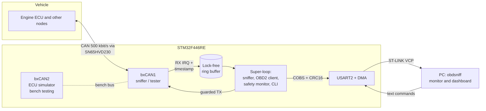

# OBD2 CAN Sniffer

A vehicle CAN bus analyzer and OBD2 diagnostic tool built on an STM32F446RE (Arm Cortex-M4F)
in bare-metal C. It passively captures traffic on a car's diagnostic port, queries standard OBD2
data (engine RPM, vehicle speed, coolant temperature, VIN, trouble codes), and streams everything
to a PC over a framed binary link for live display and logging.

The firmware is designed around one rule: **the tool must never disturb the vehicle network.**
It boots in listen-only mode, every transmit goes through a single guarded path, and any sign of
bus trouble drops it back to silent operation.

> Under active development. See [Project status](#project-status) for what is implemented and verified today.

## Highlights

- **Passive CAN capture** with the on-chip bxCAN controller in silent mode, hardware ID filters,
  and microsecond timestamps taken in the receive interrupt
- **OBD2 diagnostics (SAE J1979)**: live PIDs, VIN, read/clear diagnostic trouble codes, with an
  ISO-TP (ISO 15765-2) transport layer for multi-frame messages
- **Safety-by-design**: silent boot, transmit allowlist and rate limiting, bus-health fallback,
  host heartbeat, independent watchdog, and a DTC-clear interlock, documented in an FMEA with
  fault-injection tests
- **Efficient data path**: interrupt to lock-free ring buffer to COBS-framed, CRC-16 protected
  binary packets over DMA-driven UART
- **Low power**: drops into STOP mode when the bus goes quiet and wakes on CAN activity
- **Python host tool**: terminal monitor and a live dashboard with CSV and candump log export
- **Testable without a car**: an ECU simulator on the chip's second CAN controller, connected over
  a single-wire open-drain bus, exercises the full stack on a desk
- **Engineering practice**: CMake cross-build, pinned vendor submodules, host-side unit tests for
  all hardware-independent code, static analysis, and CI on every pull request

## System architecture



**Receive path.** The CAN receive interrupt timestamps each frame from a free-running 32-bit
microsecond timer and pushes it into a single-producer/single-consumer ring buffer. The main loop
drains the buffer, encodes frames into compact binary packets, and hands them to a DMA-driven
UART. The interrupt does no formatting and never blocks.

**Transmit path.** Only the OBD2 client transmits, and only through a guard that enforces an
allowlist of diagnostic CAN IDs and services plus a token-bucket rate limit. The guard is plain C
with no hardware dependencies and is unit-tested on the host.

**Operating modes.**

| Mode | CAN controller | Purpose |
|---|---|---|
| `SNIFF` (default at boot) | Silent / listen-only | Capture all traffic; cannot transmit or acknowledge |
| `OBD` | Normal, guarded TX | Poll selected PIDs, read VIN and DTCs |
| `LOOPBACK` | Internal loopback | Self-test of the full stack with no external hardware |

## Hardware

| Component | Role |
|---|---|
| NUCLEO-F446RE | STM32F446RE, Cortex-M4F at 180 MHz, 512 KB flash, 128 KB SRAM, two bxCAN controllers |
| SN65HVD230 | 3.3 V CAN transceiver between the MCU and the vehicle bus |
| OBD2 (SAE J1962) cable | Pin 6 CAN-H, pin 14 CAN-L, pin 5 signal ground |

### Pin map

| Signal | Pin | Notes |
|---|---|---|
| CAN1 RX / TX | PB8 / PB9 (AF9) | Arduino D15 / D14 |
| CAN2 RX / TX | PB12 / PB13 (AF9) | Morpho CN10; ECU simulator |
| USART2 TX / RX | PA2 / PA3 (AF7) | ST-LINK virtual COM port |
| LD2 | PA5 | Status LED |
| B1 | PC13 | User button, active low |

### Clock tree

The 8 MHz clock from the on-board ST-LINK feeds the PLL in HSE bypass mode
(8 MHz / 4 x 180 / 2 = 180 MHz). APB1 runs at 45 MHz, which clocks bxCAN, USART2 and TIM2. If the
external clock fails to start, the firmware falls back to the internal 16 MHz HSI with the same
PLL output and reports it at boot, since HSI tolerance is marginal for CAN timing.

At 500 kbit/s the CAN bit time is 18 time quanta (prescaler 5, BS1 = 15, BS2 = 2), giving an
88.9% sample point.

## Design decisions

- **STM32 HAL with a hand-written linker script.** The HAL handles peripheral register sequences;
  the memory layout, startup flow and section placement are owned by the project. The linker
  script adds a `.noinit` region that survives warm resets (for crash reports) and a link-time
  check that fails the build if static RAM leaves less than 8 KiB for the stack.
- **No heap.** All buffers are statically sized. `_sbrk` always fails, so an accidental `malloc`
  returns NULL rather than silently consuming stack space.
- **Vendor code isolated.** ST's HAL and CMSIS are pinned git submodules compiled as a separate
  library. Project code builds with `-Wall -Wextra -Werror` and additional warnings.
- **Binary link protocol.** At 921600 baud a text line per frame tops out near 2,500 frames/s,
  below the worst case of a busy 500 kbit/s bus. COBS-framed binary packets of about 18 bytes
  roughly double that headroom, and the CRC-16 lets the host detect corrupted packets.
- **Portable core.** Protocol encoding, ISO-TP, OBD2 decoding, the command parser and the transmit
  guard are pure C with no HAL includes, so they are unit-tested on the development machine and
  in CI.

## Project status

| Component | Status |
|---|---|
| CMake cross-build, pinned HAL/CMSIS submodules, custom linker script | Implemented |
| 180 MHz clock tree with HSE to HSI fallback | Implemented |
| UART console, boot banner, reset-cause reporting | Implemented |
| CI (firmware build and size report) | In progress |
| Interrupt/DMA UART, command line interface, watchdog, fault capture | Not started |
| CAN driver, ring buffer, binary link, Python monitor | Not started |
| ISO-TP, OBD2 client, ECU simulator | Not started |
| Safety layer, FMEA, fault injection | Not started |
| Dashboard, low power, vehicle testing, custom PCB | Not started |

## Building and flashing

Requirements: [Arm GNU Toolchain](https://developer.arm.com/downloads/-/arm-gnu-toolchain-downloads)
(`arm-none-eabi-gcc`), CMake 3.25 or newer, Ninja, and OpenOCD for flashing.

```sh
git clone --recurse-submodules https://github.com/ka5j/obd2-sniffer.git
cd obd2-sniffer

cmake --preset firmware                     # configure (Debug, -Og -g3)
cmake --build --preset firmware             # build: .elf, .bin, .hex and a size report
cmake --build --preset firmware --target flash   # program the Nucleo over ST-LINK
```

Use the `firmware-release` preset for a size-optimised build.

Open the ST-LINK virtual COM port at 115200 baud 8N1 (for example
`screen /dev/tty.usbmodem* 115200`) and press the black reset button to see the boot banner:

```
========================================
 OBD2 CAN Sniffer  v0.1.0
----------------------------------------
 MCU      STM32F446RE  rev 0x1000
 UID      XXXXXXXX-XXXXXXXX-XXXXXXXX
 Clock    HSE 8 MHz bypass
 SYSCLK   180 MHz
 PCLK1    45 MHz   PCLK2 90 MHz
 Reset    reset pin
========================================
```

## Repository layout

```
cmake/               toolchain file and build helper scripts
firmware/
  include/           board, clock, console headers; HAL configuration
  src/               application sources
  linker/            STM32F446RE linker script
  third_party/       ST HAL, CMSIS device and CMSIS core (git submodules)
CMakePresets.json    configure and build presets
```

## License

MIT. See [LICENSE](LICENSE).
