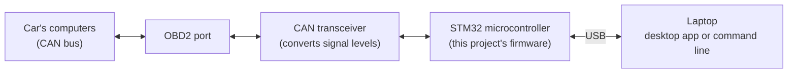

# OBD2 CAN Sniffer

A small device that plugs into a car's diagnostic port, listens to the conversations between the
car's computers, and shows live engine data on a laptop. It is built from scratch on an STM32
microcontroller, with a desktop app and a command-line tool for the laptop side.

> Under active development. See [Project status](#project-status) for what works today.

## The idea in plain terms

A modern car has dozens of small computers (ECUs) controlling the engine, brakes, airbags and
dashboard. They talk to each other over a shared wired network called the **CAN bus**. Since 2008,
every car sold in North America exposes that network through the **OBD2 port** under the
dashboard. Mechanics plug their scan tools into the same port.

This project is a scan tool and network analyzer I am building myself:

- **Listen:** record every message on the car's network, with precise timestamps, without
  interfering with it.
- **Ask:** request standard diagnostic data from the engine computer, such as RPM, speed, coolant
  temperature, throttle position, the vehicle identification number (VIN), and check-engine
  trouble codes.
- **Show:** stream everything to a laptop, where it can be watched live, graphed, and saved.

## Highlights

- **Safety first.** A tool on a car's network must never disrupt it. The device starts in a
  listen-only mode, can only send a short list of approved diagnostic requests, and goes silent
  on its own if anything looks wrong. Each failure scenario is analysed in a written failure-mode
  analysis and tested by deliberately causing it.
- **Three ways to use it.** A desktop app with live graphs, a command-line tool for the terminal,
  or plain typed commands in any serial terminal with nothing to install.
- **Built to keep up with a busy network.** Messages are captured the moment they arrive and moved
  to the laptop in a compact, error-checked format, so none are lost when traffic is heavy.
- **Battery friendly.** When the car is off and the network goes quiet, the device sleeps and
  wakes up automatically when traffic resumes.
- **Testable without a car.** The microcontroller has two network controllers. One acts as a fake
  engine computer, so the whole system can be developed and tested on a desk.
- **Professional workflow.** Automated builds and tests on every change, unit tests for the core
  logic, version-tagged releases, and a custom circuit board as the final step.

## How it works



1. The **transceiver** chip converts the car's network signals into logic levels the
   microcontroller can read.
2. The **firmware** on the STM32 captures each message, timestamps it, and decides what to do:
   pass it on, answer a request, or ignore it.
3. The **laptop software** receives the data over USB and displays it.

## Ways to use it

| Interface | What it looks like | Good for |
|---|---|---|
| Desktop app | `obdsniff gui`: a window with connection controls, live data and a console | Watching live data, demos |
| Command-line tool | `obdsniff info`, `obdsniff shell`, ... | Quick checks, scripting, logging |
| Serial terminal | Open the board's USB serial port and type `help` | Using the device with no software installed |

## Skills demonstrated

| Area | Details |
|---|---|
| Embedded C | Bare-metal firmware on an Arm Cortex-M4, no operating system |
| Microcontroller peripherals | Clocks, UART serial, DMA, timers, watchdog, CAN controller, low-power modes |
| Automotive protocols | CAN, OBD2 (SAE J1979), ISO-TP multi-frame transport |
| Reliability and safety | Watchdog, crash capture, fault injection, failure-mode analysis (FMEA) |
| Python | Desktop app (PySide6), command-line tool, serial communication |
| Testing and tooling | Unit tests in C and Python, CMake, GitHub Actions CI, Git branching workflow |
| Hardware | Bench wiring, logic analyzer debugging, custom PCB in KiCad |

## Project status

| Part | Status |
|---|---|
| Build system, project structure, automated builds (CI) | Done |
| Microcontroller start-up: 180 MHz clock, serial console, start-up report | Done, awaiting hardware check |
| Interactive console, watchdog, crash reporting | In progress |
| Laptop tool: command line, desktop app, simulated device | In progress |
| Unit tests in CI | In progress |
| Capturing CAN messages and streaming them to the laptop | Not started |
| OBD2 requests: live data, VIN, trouble codes | Not started |
| Two-controller test bus on the desk, performance measurements | Not started |
| Safety layer with failure-mode analysis and fault-injection tests | Not started |
| Live graphs and logging in the desktop app | Not started |
| Sleep mode when the car is off | Not started |
| Testing in a real car | Not started |
| Custom circuit board | Not started |

## Hardware

- **NUCLEO-F446RE** development board (STM32F446RE microcontroller: Arm Cortex-M4, 180 MHz,
  512 KB flash, 128 KB RAM)
- **SN65HVD230** CAN transceiver module
- **OBD2 cable** to connect to the car

Wiring and pin assignments are in [docs/design/hardware.md](docs/design/hardware.md).

## Getting started

You need the [Arm GNU Toolchain](https://developer.arm.com/downloads/-/arm-gnu-toolchain-downloads),
CMake, Ninja and OpenOCD.

```sh
git clone --recurse-submodules https://github.com/ka5j/obd2-sniffer.git
cd obd2-sniffer
cmake --preset firmware
cmake --build --preset firmware                  # build the firmware
cmake --build --preset firmware --target flash   # load it onto the board over USB
```

Then open the board's serial port at 115200 baud (for example
`screen /dev/tty.usbmodem* 115200`) and press the reset button to see the start-up report.

## Documentation

Each document starts with a short plain-language summary, followed by the engineering detail.

- [Hardware and wiring](docs/design/hardware.md)
- [Build system and start-up sequence](docs/design/build-and-boot.md)

## License

MIT. See [LICENSE](LICENSE).
