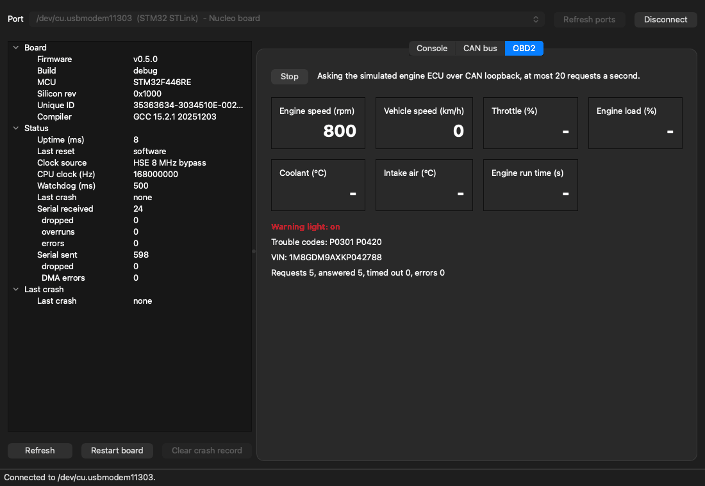
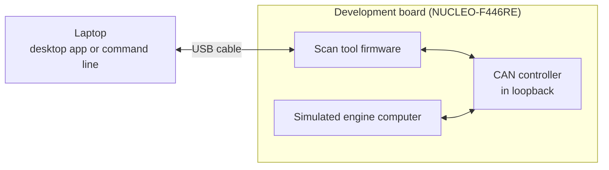

# OBD2 CAN Sniffer

[](https://github.com/ka5j/obd2-sniffer/actions/workflows/ci.yml)
[](https://ka5j.github.io/obd2-sniffer/)
[](https://github.com/ka5j/obd2-sniffer/releases/latest)

A read-only scanner for a car's diagnostic port. It records the messages between the car's computers,
asks the engine computer for live data, trouble codes and the VIN, and shows it all on a laptop. It
only ever asks standard questions, and can't change anything in the car.

Today it runs on an STM32 development board, against a simulated engine computer. The goal is its own
custom circuit board that plugs straight into the car.



## Where it stands

| | |
|---|---|
| **Works today** | On a development board with no car: CAN capture with nothing lost unnoticed, OBD2 live data, trouble codes and VIN, a transmit guard, crash recovery, and a desktop app and command line |
| **Not done yet** | It hasn't been on a real CAN bus or in a real car |
| **The goal** | A custom circuit board that runs from the car's 12 V supply, with a hardware switch that turns the transmitter off. It is designed, not built |

The full list is in [Project status](#project-status).

## Try it, no hardware needed

The laptop software includes a simulator of the whole board. You need Python 3.10 or newer, and Git:

```sh
git clone https://github.com/ka5j/obd2-sniffer.git
cd obd2-sniffer
python3 -m venv .venv
source .venv/bin/activate          # Windows: .venv\Scripts\activate
pip install -e "host[gui]"         # the desktop app's Qt library is a large download
obdsniff --port sim gui
```

Press **Connect**, open the **OBD2** tab, and press **Start**.

To go further, with a real board and ready-made firmware, or building from source, see
[Getting started](docs/getting-started.md).

## How it works

A car's computers share one pair of wires, the **CAN bus**, and the **OBD2 port** under the dashboard
is the way in. On the bus, every computer sees every message. So a tool can listen to it all, and ask
the engine computer standard questions such as "what is the engine speed?".

With no car, the development board plays both sides:



1. The **laptop** asks one question at a time, and shows the answers.
2. The **firmware** sends each question through its CAN controller, timestamps and numbers every
   message it receives, and sends them to the laptop.
3. The **CAN controller** runs in loopback: it receives its own messages and nothing leaves the chip,
   so a simulated engine computer on the same board can answer through real CAN hardware.

[How it works](docs/how-it-works.md) explains all of this from the beginning, with no car knowledge
assumed.

## Why it's worth a look

- **Nothing is lost unnoticed.** Every message is timestamped to the microsecond and numbered the
  moment it arrives. Measured on the board in loopback: 100,000 messages at 100% network load, none
  lost. When traffic outgrows the USB link, every dropped message is counted and reported.
- **Read-only by design.** The board asks only when the laptop tells it to, and every frame it sends
  passes a transmit guard that allows only read requests, at most 20 a second. Clearing a trouble code
  isn't built in. [The safety design](docs/design/safety.md) adds a hardware switch, and lists the
  risks that remain.
- **Recovers from crashes and says why.** A watchdog restarts the board if the program stops
  responding, and a crash handler records the fault type and code address, then reports them after
  the restart.
- **Tested to safety-critical standards.** The core logic is unit-tested to 100% MC/DC coverage, the
  coverage standard used for flight-control software, and all C code follows the MISRA C:2012 rules
  used in the automotive industry, with every exception documented. See the
  [live quality report](https://ka5j.github.io/obd2-sniffer/).
- **Requirements with a test for each.** What the device must do, survive and never do is written
  down as [numbered requirements](docs/design/requirements.md), each with its test and its honest
  status today.
- **Every release is checked on the board.** The published files are built by CI from the tag, then
  flashed onto the board and checked before they go out.

## Where to go next

| You want to... | Read |
|---|---|
| Understand how it works, from the beginning | [How it works](docs/how-it-works.md) |
| Run it, with or without a board | [Getting started](docs/getting-started.md) |
| Use the desktop app, command line or Python library | [The laptop tool](host/README.md) |
| Judge the engineering | [Safety](docs/design/safety.md), [requirements](docs/design/requirements.md), [testing](docs/design/testing.md) and [how the firmware fits together](docs/design/architecture.md) |
| See the circuit board design | [Circuit board](docs/design/circuit-board.md) |
| See every document | [Documentation](docs/README.md) |

## Measured on the board

All of these are in loopback, on a development board.

| What | Result |
|---|---|
| CAN capture, 500 kbit/s at 100% load | 100,000 messages, 0 lost, 0 damaged |
| CAN overload, 1 Mbit/s at 100% load (Release build) | The bus outruns the USB link: 5,209 of 20,000 dropped, each one counted on the board and seen as a gap on the laptop. With streaming off, 0 dropped |
| Commands while the CAN bus is full | 2,623 commands as 42,127 messages arrived, none failed, no byte lost |
| OBD2 against the simulated engine computer | 201 requests in 10 s (the transmit guard allows at most 20 a second), every one answered, 0 timeouts, 0 refused by the guard; none once the laptop stops asking |
| Longest CAN receive interrupt | 6 to 9 µs in the Release build and 10 to 14 µs in Debug across runs, with OBD2 traffic (the time includes serial interrupts that preempt it), against 238 µs between messages at full load |
| Watchdog | A stuck board restarts after 535 ms and reports why |

How each number was measured: [testing.md](docs/design/testing.md#checks-on-the-board).

## Topics covered by this project

| Area | Details |
|---|---|
| Embedded C | Bare-metal firmware on an Arm Cortex-M4, no operating system |
| Microcontroller peripherals | Clocks, UART serial, DMA, timers, interrupts, watchdog, CAN controller |
| Automotive protocols | CAN, OBD2 (SAE J1979), ISO-TP multi-frame transport |
| Reliability | Watchdog, crash capture and reporting, interrupt priorities set by deadline, flow control |
| Safety engineering | Numbered requirements each with a test, a layered read-only safety design with a hardware interlock, failure-mode analysis (FMEA) |
| Python | Desktop app (PySide6), command-line tool, serial communication, board simulator |
| Code quality | MISRA C:2012 compliance with documented deviations, static analysis (cppcheck), worst-case stack analysis |
| Testing and tooling | Unit tests in C (Unity) and Python, 100% MC/DC coverage, sanitizers, CMake, GitHub Actions CI, Git branching workflow |

## Repository layout

| Folder | What's in it |
|---|---|
| [`firmware/`](firmware) | STM32 firmware, one folder per subsystem: `system`, `console`, `can`, `obd`, `fault` (and `hal`, ST's driver settings) |
| [`lib/`](lib) | Portable C with no hardware code: buffers, link encoding, console logic, CAN timing, ISO-TP, OBD2 and the transmit guard. Compiled into the firmware and unit-tested on a laptop |
| [`tests/`](tests) | C unit tests, in the same folders as `lib/` |
| [`host/`](host) | The laptop tool `obdsniff`: command line, desktop app, board simulator |
| [`scripts/`](scripts) | Board check, coverage, MISRA and stack-use gates, quality report, screenshots, release-file and link checks |
| [`docs/`](docs) | [All the documents](docs/README.md) |
| [`misra/`](misra) | MISRA policy: every deviation and its reason |

## Project status

| Part | Status |
|---|---|
| Build system, project structure, automated builds (CI) | Done |
| Microcontroller start-up: 168 MHz clock, start-up report, reset-cause reporting | Done, verified on hardware |
| Serial link to the laptop: interrupt and DMA driven, one command protocol, board commands | Done, verified on hardware |
| Watchdog and crash capture with reports after restart | Done, verified on hardware |
| Laptop tool: command line, interactive shell, board simulator | Done, verified on hardware |
| Laptop tool: desktop app with board status, controls and console | Done, verified on hardware |
| Unit tests with 100% MC/DC coverage gate, published test and coverage reports | Done |
| MISRA C:2012 compliance check in CI, published compliance report | Done |
| Worst-case stack use worked out and checked in CI | Done |
| Capturing CAN messages and streaming them to the laptop | Done (tested in loopback), verified on hardware |
| OBD2 requests: live data, VIN, trouble codes, from a simulated engine computer in loopback | Done, verified on hardware |
| Transmit guard: only read requests, rate limited, sent only when the laptop asks | Done (tested in loopback), verified on hardware |
| Requirements, read-only safety design, failure-mode analysis, circuit board design | Done (written down; see [Documentation](docs/README.md)) |
| Real CAN bus on the desk with two transceivers, bus fault tests | Not started |
| USB straight from the microcontroller, with no programmer chip in between | Not started |
| Silent bit-rate detection and the bus-error latch | Not started |
| Circuit board revision A: schematic, layout, bring-up | Not started |
| Sleep mode when the car is off | Not started |
| Testing in a real car | Not started |
| Circuit board revision B: the device that plugs into the car | Not started |

## License

MIT. See [LICENSE](LICENSE).
