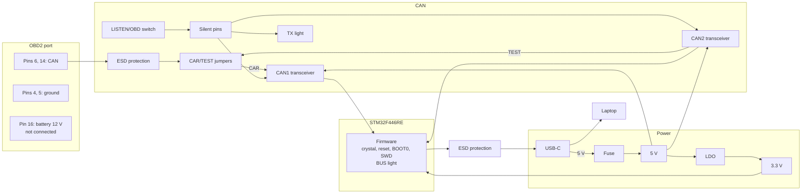

# The circuit board

Part of the [project documentation](../README.md).

> **Status:** in design, not built yet. This document records the design and the reasons
> behind each choice. Part numbers, and the datasheet each value was checked against, are in the
> [revision A brief](../../hardware/rev-a/README.md).

## In short

The project's own circuit board turns the development-board setup into a device that plugs
into a car's diagnostic port. It does the same job as today's setup, and it enforces the
[read-only safety design](safety.md) in hardware.

**It is powered from the laptop's USB port only.** The board is useless without the laptop, and
the laptop's USB port already supplies all the power it needs. So the car's 12 V supply never
enters the board: the connector for the car has three terminals, CAN high, CAN low and ground.
That removes the car's battery voltage from the board altogether, and with it the risks of
draining the battery and of surviving the car's electrical spikes.

Every part on the board has to trace to a requirement in [requirements.md](requirements.md).
There is nothing on it "just in case": no wireless, no memory card, no display. Each of those
would be one more thing to fail or to make unsafe.

It is built in two revisions:
- **Revision A** is for bring-up and testing. It has room to probe, test points on every
  important signal, and a debug header.
- **Revision B** is the finished, compact device that plugs straight into the port. It takes the
  fixes found on revision A.

| Term | Meaning |
|---|---|
| Schematic | The circuit diagram: which parts there are and how they connect |
| Layout | Where each part and copper track goes on the physical board |
| Transceiver | The chip between the microcontroller and the two CAN wires |
| LDO | A simple regulator that makes a clean, lower voltage (here 5 V to 3.3 V) |
| ESD | Electrostatic discharge: the spark when you touch something; it can destroy chips |
| Bring-up | Powering and testing a new board for the first time, one section at a time |

## Block diagram

Ground (pins 4 and 5) is the board's ground. Pin 16 has no terminal on the board.

## Each block and why it is there

### Power from USB

| Part | Why |
|---|---|
| USB-C socket | Power and data over one cable (PWR-5, LNK-3) |
| Two resistors on the socket's CC pins | They tell a USB-C port that a device is attached, so it switches its 5 V on |
| Fuse | A short on the board can't draw a dangerous current from a strong USB-C supply |
| LDO, 5 V to 3.3 V | The microcontroller's supply. The transceivers run from the 5 V directly |

**Why not the car's 12 V.** An earlier version of this design also ran from the port's pin 16.
It was removed, because it added a fuse, reverse-battery protection, a spike clamp, a converter
and a sleep mode, all to power a board that does nothing unless a laptop is plugged into it. The
laptop is always there, and so is its 5 V.

With the laptop unplugged the board is unpowered. The transceiver chosen disconnects from the
bus when it has no supply, so an unpowered board left in the port takes nothing from the car and
puts no load on its network (PWR-8).

### USB data

The microcontroller's own USB port connects directly to the socket, through an ESD protection
chip. It appears on the laptop as a serial port that needs no driver (LNK-3). The data pair is
routed as a matched pair at 90 ohms. The chip's built-in USB bootloader, entered with the BOOT0
button, lets the firmware be updated with no debugger (USE-4).

### Microcontroller

The STM32F446RE, the same chip as on the development board, so the firmware carries over.
Around it:
- an 8 MHz crystal (USB needs a precise clock, and the development board borrowed its clock from
  its programmer chip);
- decoupling capacitors at every supply pin, following ST's application note AN4488;
- a reset button;
- a BOOT0 button;
- a SWD debug header for programming and debugging.

### CAN

| Part | Why |
|---|---|
| CAN1 transceiver: automotive grade, 5 V supply with 3.3 V logic, a silent pin, a dominant timeout, bus pins that withstand a short to the car's battery | The connection to the car. The silent pin is the hardware safety layer. The dominant timeout releases the bus if the transmit input is ever stuck |
| ESD protection on CANH and CANL | Plugging into a car can bring a static discharge with it |
| Termination solder jumper, **open by default** | The car's bus is already terminated at each end. A third resistor would change it (CAN-6). Closed only for desk tests |
| CAN2 transceiver, reachable **only** through the TEST position | A second node, so the board can test both transceivers and the wiring before going near a car (CAN-7) |

### The CAR/TEST jumpers

The self-test needs CAN1 and CAN2 on one bus. On a car, CAN2 must never be on the bus: a second
node would acknowledge the car's messages and add a termination resistor.

So CAN1's two bus wires go to the middle pins of a three-position header. One side of the header
is the car connector, and the other side is CAN2. A jumper cap joins the middle to one side only:

| Position | CAN1 is connected to | Use |
|---|---|---|
| CAR | The car connector | Normal use |
| TEST | CAN2, with its own termination | The self-test |

No position of the jumpers connects CAN2 to the car connector. In TEST the car connector is
disconnected, so a self-test can't reach a car even if the cable is plugged in.

### The LISTEN/OBD switch and the TX light

The transceiver's silent pin decides whether it can transmit. Left unconnected, the chip's own
internal resistor selects "able to transmit", which is the wrong default for this device. So a
stronger resistor on the board pulls the pin to "silent".

The firmware can enable the transmitter only through the switch: in LISTEN, the switch breaks
that path, so the pin stays silent whatever the firmware does. After a reset, a crash, or with a
blank chip, the firmware isn't driving the path either, so the pin is silent then too. Both
transceivers share the one silent signal.

The **TX light** is switched by the silent signal itself, through a transistor so that the light
can't disturb the signal. It shows what the transceivers are actually set to. If it is off, the
board can't transmit.

### Lights

Three single-colour lights, each labelled on the board. With labels, each one's meaning is
obvious, where a colour code would have to be memorised.

| Light | Driven by | Meaning |
|---|---|---|
| PWR | The 3.3 V supply directly | The board has power, even with no firmware |
| BUS | Firmware | Off: no bus found. Blinking: traffic. Fast blinking: bus error, or an unsupported bus |
| TX | The silent signal | Lit only while the board is able to transmit |

### Revision A only

- Test points on every supply rail and every bus signal.
- A header for the debug serial port.
- Screw terminals for the OBD2 cable, instead of a plug, so wiring can be checked.

## Left out on purpose

| Not on the board | Why |
|---|---|
| Power from the car's 12 V, a battery-voltage reading, a sleep mode | The laptop powers the board; see [Power from USB](#power-from-usb) |
| Bluetooth, Wi-Fi | A radio adds a new way in, certification and a lot of firmware; USB does the job |
| SD card, display, buzzer, extra buttons | Not needed for the job; each is something more to fail |
| K-line, J1850 | Older OBD2 protocols; every car sold in North America since 2008 uses CAN |
| CAN FD | The microcontroller's CAN controller is classic CAN; on a CAN FD bus the board stays silent ([safety.md](safety.md#classic-can-only)) |
| Any power output | Nothing on the board feeds power back to the car or to other devices |
| Spare connectors (revision B) | Unused pins are an invitation to wiring mistakes |

## Making it

- **Design:** KiCad. The design files go in [`hardware/`](../../hardware/README.md), and the
  [revision A brief](../../hardware/rev-a/README.md) is the working sheet for this board.
- **Board:** 4 layers (signal, ground, power, signal). A solid ground layer keeps the USB and CAN
  signals clean.
- **Assembly:** small parts soldered by the board maker; connectors fitted by hand.
- **Bring-up:** one block at a time, each checked before the next:
  1. check the board for shorts;
  2. power from a current-limited supply;
  3. program it over SWD;
  4. check USB;
  5. run the self-test;
  6. only then, the car ([safety.md](safety.md#the-order-of-car-tests)).
