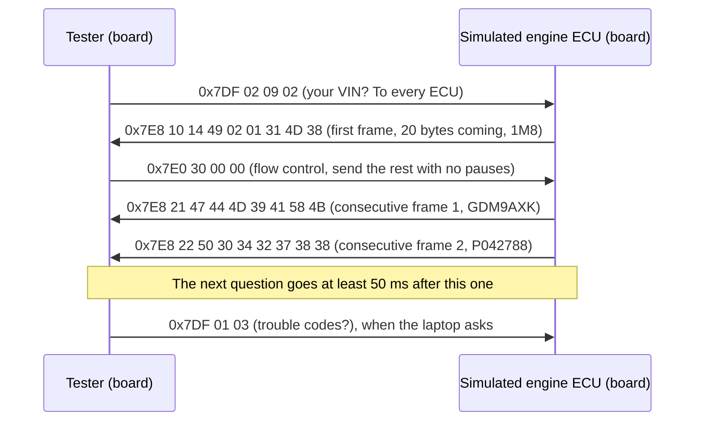

# OBD2: asking the car for live data, trouble codes and its VIN

Part of the [project documentation](../README.md).

## In short

A sniffer listens; a diagnostic tool also asks. OBD2 is the standard set of questions every car
since 1996 (US) or 2001 (EU) must answer on its diagnostic port: "how fast is the engine
turning?", "which fault codes are stored?", "what is your vehicle identification number?".

- **The tester.** The board has an OBD2 tester built in, but it never asks anything on its own:
  it sends one question each time the laptop says `obd ask`, and keeps the answer. The laptop
  works through a plan: the VIN first, then the stored trouble codes and the warning-light
  status every 5 seconds, and in between seven live values (engine speed, vehicle speed,
  throttle, engine load, coolant and intake temperature, engine run time) in turn. At most 20
  questions a second, the limit of the board's transmit guard. If the laptop stops asking, the
  board stops sending.
- **The simulated car.** With only the development board available, there is no car to ask. In
  loopback the CAN controller receives every frame it sends, so the board plays the car as well:
  a simulated engine control unit (ECU) answers the tester, all through the real CAN controller.
  Its engine repeats a 30-second drive (idle, accelerate, cruise, slow down), warms up over
  90 seconds, has two stored trouble codes and a valid VIN.
- **Long answers.** A CAN frame carries at most 8 bytes, but the VIN answer is 20. ISO-TP, the
  transport layer OBD2 uses on CAN, splits it into numbered frames, and the receiver paces the
  sender with *flow control*.
- **Read-only.** The tester asks only service 01 (live data), 03 (stored trouble codes) and 09
  (vehicle information) questions. Clearing trouble codes (service 04), or anything else that
  changes an ECU, is not built in, on purpose ([safety.md](safety.md#what-read-only-means)).
- **Two ways to use it.** `obdsniff obd watch` on the laptop, or the desktop app's OBD2 tab.

Measured on the board: **201 questions in 10 seconds (20 a second), every one
answered, 0 timeouts, 0 errors**; the multi-frame VIN and both trouble codes read correctly.

| Term | Meaning |
|---|---|
| OBD2 | On-Board Diagnostics, second generation: the standard questions and the port they are asked on (SAE J1979, ISO 15031) |
| ECU | Electronic control unit: one of the car's computers. The engine ECU answers most OBD2 questions |
| PID | Parameter ID: which value a question is about, e.g. 0C for engine speed |
| DTC | Diagnostic trouble code, e.g. P0301 (cylinder 1 misfire): a fault the ECU has recorded |
| MIL | Malfunction indicator lamp: the "check engine" warning light |
| VIN | Vehicle identification number: 17 characters, unique to each car |
| ISO-TP | ISO 15765-2: splits messages longer than one CAN frame and reassembles them |

## The conversation

Requests go to 0x7DF, which every emissions-related ECU listens to. The engine ECU replies from
0x7E8, and flow control for its long replies goes to its own ID, 0x7E0. In loopback all of these
frames are also captured and streamed, so `obdsniff monitor` shows the conversation.

## Engineering detail

### Layers

All the protocol logic is portable C in `lib/`, unit-tested on the laptop to 100% MC/DC:

| Module | Job |
|---|---|
| `isotp.c` | ISO-TP sender and receiver: single, first, consecutive and flow-control frames; block size, STmin, wait frames, timeouts |
| `obd2.c` | Reply formats: PID formulas, monitor status, trouble codes and their text form, VIN |
| `obd_client.c` | The tester: the request plan, reply timeout, the latest answers and counters |
| `tx_guard.c` | The transmit guard: the only frames the board may send, and how often ([safety.md](safety.md#the-layers)) |
| `ecu_sim.c` | The simulated engine: a pure function of elapsed time, so tests check exact bytes |
| `ecu_node.c` | ISO-TP around `ecu_sim`, so the simulated ECU sits on the bus like a real one |

The firmware side is thin: `firmware/obd/obd.c` routes frames between the CAN driver and the two
nodes, and `commands.c` adds the `obd` command.

### State machines that never wait

The firmware is a single main loop with a watchdog, so nothing may block. Each ISO-TP sender and
receiver is a state machine with three entry points:

- `..._frame(data)`: a frame arrived;
- `..._poll(now)`: is there a frame to send, or has a timeout expired?
- `..._sent(now)`: the frame from the last poll was accepted by the CAN controller.

Poll keeps handing out the same frame until `sent` confirms it. If all three transmit mailboxes
are busy, the transfer is simply delayed by a pass of the main loop, never corrupted. This
mirrors the standard, where the data link layer confirms each transmission (`L_Data.confirm`),
and timers such as STmin start from that confirmation.

### Timing

| Limit | Value | Source |
|---|---|---|
| ECU reply must start within | 50 ms | ISO 15765-4 (P2) |
| Gap between consecutive frames of a reply (receiver gives up after) | 1 s | ISO 15765-2 default (N_Cr) |
| Wait for flow control (sender gives up after) | 1 s | ISO 15765-2 default (N_Bs) |
| "Wait" flow-control frames accepted in a row | 10 | N_WFTmax |
| Tester's pause between a reply and the next request | 50 ms | at most 20 requests a second, the transmit guard's limit ([safety.md](safety.md#the-layers)) |

Once the first frame of a reply has arrived, the 50 ms limit no longer applies: ISO-TP times the
rest. Times are microseconds from the 32-bit timebase and compared in a way that survives the
counter wrapping every 71 minutes.

### Getting frames to the tester

The capture path has one queue between the receive interrupt and the stream to the laptop. The
tester and the simulated ECU need the same frames, but must not wait while the serial link is
busy or while streaming is switched off. So the interrupt also copies OBD2 frames (to 0x7DF and
0x7E0, from 0x7E8) into a second, small queue. Each queue keeps exactly one producer (the
interrupt) and one consumer, which is what makes the lock-free queue safe. The extra copy
raises the longest receive interrupt from 7 to 10 µs, against 238 µs between frames at full
load.

### Values without floating point

Each PID's reply bytes map to a value by a formula from SAE J1979, e.g. engine speed is
(256·A + B) / 4 rpm and throttle is A·100/255 %. Values are kept as integers scaled by
10^decimals: 23.5% throttle is 235 with one decimal. The same table gives each value the key it
is reported under; the laptop tool gives it a label.

### The simulated ECU

`ecu_sim.c` follows a table of keyframes (time, engine speed, vehicle speed, throttle) and
interpolates between them with integer arithmetic. Like a real ECU it stays silent for services
and PIDs it doesn't support. The laptop's simulator (`host/src/obdsniff/sim/obd.py`) follows the
same model, and a test reads the C sources to check that the keyframes, VIN, trouble codes and
PID table match.

### Safety

The tester only runs in loopback, so nothing reaches a car. Every frame it sends also passes the
transmit guard, which allows only the read requests and their flow control, at most 20 requests
a second. Clearing trouble codes (service 04) is not implemented, and the guard refuses it: a
tool that can't clear codes can't clear them by accident ([safety.md](safety.md)).

## Checks on the board

| Check | Result |
|---|---|
| `obd ask` with CAN off | Refused |
| After 2 s | 220 requests, 220 replies; VIN, both trouble codes and the warning light right |
| After 10 s | 838 requests (about 95 a second), 0 timeouts, 0 errors; values follow the simulated drive (v0.4.0, before the transmit guard; now 199 in 10 s, `board_check.py`) |
| Bus | 1,775 frames sent and 1,775 received, 0 dropped, with streaming off |
| Longest receive interrupt | 10 µs with OBD2 traffic; since v0.5.0, 14 µs in the Debug build and 9 µs in Release (a 168 MHz CPU, and the laptop asks each question: the time includes serial interrupts that preempt it) |
| Laptop stops asking | No more requests (`board_check.py` waits 1 s and checks the count) |
