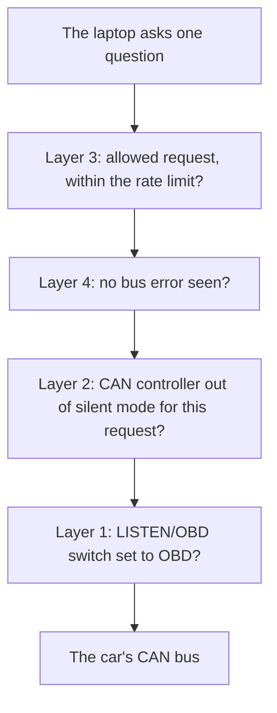

# Safety: a read-only scanner

Part of the [project documentation](../README.md).

## In short

This device is meant to plug into a real car, so the first design goal is that it can't harm the car.

**Read-only.** The device asks the car only standard read-only questions: live data, stored
trouble codes and the VIN. Mechanics' scan tools ask the same questions every day, and they
change nothing in the car. Anything that could change the car, such as clearing trouble codes,
writing settings or resetting a computer, is not built into the device at all, so no bug can
trigger it.

**Safety in layers, hardware first.** A single safety check, however well tested, is a single
point of failure. So the device has several independent layers, and each one on its own stops
the device from transmitting. The most important one is a physical switch on the circuit board,
which is designed but not built yet. In its LISTEN position, the chip that drives the car's network
is electrically unable to transmit, whatever the firmware does.

**Honest limits.** No engineer can promise that a device is "impossible" to harm a car with.
What this design promises, and has to prove on the bench before it goes near a car, is narrower:
- in LISTEN mode, the device can't transmit even if its firmware tries;
- in OBD mode, it can only send standard read requests, slowly.

The risks that remain are mostly electrical, such as a wiring fault putting 12 V on the network
wires. They are listed below with how each is handled, along with the order the car tests
follow.

| Term | Meaning |
|---|---|
| CAN bus | The two-wire network the car's computers share. Every device on it can see every message |
| Transceiver | The chip between the microcontroller and the bus wires. It has a pin that turns its transmitter off |
| Silent mode | The CAN controller listens but never drives the bus, not even to acknowledge a frame |
| Acknowledge | Every CAN receiver briefly drives the bus to confirm a frame arrived. A silent device doesn't |
| Error frame | A deliberate disturbance a CAN controller sends when it sees a bad frame; it destroys that frame for everyone |
| U-code | A trouble code a car stores when its computers lose contact with each other |
| FMEA | Failure modes and effects analysis: a list of everything that could fail, its effect, and what prevents it |

## What read-only means

The device sends only these requests, all defined by OBD2 (SAE J1979):

| Service | What it asks | Why it is safe |
|---|---|---|
| 01 | Live data: engine speed, vehicle speed, temperatures, throttle, load, run time, warning light | Read only; the ECU just reports values |
| 03 | Stored trouble codes | Read only; the codes stay stored |
| 09 | Vehicle information (the VIN) | Read only |

It sends them only to the standard OBD2 request ID (0x7DF), plus the flow-control frame
(to 0x7E0) that tells an ECU to send the rest of a long reply such as the VIN.

**Never built**, on purpose:
- service 04, which clears trouble codes and resets the emissions monitors;
- anything that writes to an ECU, resets one or opens a diagnostic session.

A device that can't clear codes can't clear them by accident. The cost is that a stored code has
to be cleared with another scanner.

## The layers

Each layer, on its own, stops a transmit. A frame has to get past all of them to reach the bus:

| Layer | What it does | Still stops a transmit if | Status |
|---|---|---|---|
| 1. LISTEN/OBD switch | Holds the transceiver's silent pin. In LISTEN, the transmitter is off electrically. A pull-up resistor holds the pin silent by default, so a reset, a crash or a blank chip also means silent | The firmware is wrong in any way | Circuit board design ([circuit-board.md](circuit-board.md)) |
| 2. Controller silent mode | The CAN controller is in silent mode except while it sends an allowed request | The switch is in OBD | Built for loopback: CAN is off at start-up and runs only in silent loopback, where nothing leaves the chip. Sending is refused in every other state. On a real bus it is unproven: see [the open question](#an-open-question-switching-the-can-controllers-mode) |
| 3. Allowlist and rate limit | Only the requests above, one at a time, at most 20 a second, and only in answer to a laptop request | The switch is in OBD and the controller is active | Built, and proven in loopback: the allowlist and rate limit (`lib/obd/tx_guard.c`) check every frame on the board's send path, and the tester sends one request per `obd ask` from the laptop, nothing on its own |
| 4. Error latch | Any bus error puts the device into silent mode until it is unplugged | Something on the bus, or in the device, is wrong | Not built |

The **TX light** on the circuit board is wired to the transceiver's silent pin itself, not
driven by firmware. It is lit only when the device is able to transmit, so it can't show
"safe" while the device isn't.

Each layer has to be proven on the bench by fault injection before the car tests. A test build
will deliberately try to transmit, with each layer in turn as the only one in the way, and a logic
analyzer on the transmit wire will confirm that nothing goes out. This needs the real bus, so it
hasn't been done yet.

### Before the switch exists

The LISTEN/OBD switch is on the circuit board, which isn't built. The first car sessions will use the
development board and a bought transceiver module, with no switch, so firmware alone would be all that
kept the device silent. That isn't enough for a first connection to a car.

So until the switch exists, **listen-only sessions have the transmit wire physically disconnected**: PB9
does not connect to the transceiver, and the transceiver's transmit input is held in its idle state, as
its datasheet requires. With that wire gone, no firmware fault can send anything through it. It is
checked with a multimeter before the transceiver is connected to the car.

### An open question: switching the CAN controller's mode

Layer 2 is not yet proven to work as described. Changing the controller between silent and normal mode
means stopping it, then waiting for it to resynchronise with the bus, and frames could be lost each
time. At up to 20 requests a second, that could break the requirement to lose no frame. This has to be
measured on a real bus. If it does lose frames, the controller may stay active for a whole OBD session,
with the transceiver's silent pin doing the gating instead.

### Finding the bit rate without disturbing the bus

A CAN controller set to the wrong bit rate sees every frame as an error. In normal mode it would
then send error frames, destroying other computers' messages. So the device finds the bit rate
in silent mode only. It tries 500, 250, 125 and 1,000 kbit/s in turn, and accepts a rate only
after receiving valid frames at it.

### Classic CAN only

The STM32F446's CAN controller supports classic CAN, which nearly every car from 2008 to 2019
uses at its diagnostic port. Some newer cars use CAN FD there, a faster format this controller
can't read. On a CAN FD bus the device reports an unsupported bus and never leaves silent mode.

## What the layers don't cover

The layers stop the device *transmitting*. These risks remain, most serious first. This table is
the first version of the device's FMEA.

| Failure | How it could happen | Effect on the car | How it is handled |
|---|---|---|---|
| 12 V on the CAN wires | Wrong cable pinout, a bent pin, damaged insulation: the OBD2 port's pin 16 is live battery voltage | Could damage an ECU's transceiver | The board has no connection for pin 16, and the cable leaves it out. Every cable is continuity-checked before use. The transceiver's bus pins and the ESD protection withstand a short to the battery |
| The device drags the bus down | A damaged transceiver, a short between CANH and CANL, or a third termination resistor. Silent mode doesn't prevent this: a broken part can load the wires without transmitting | ECUs lose contact: warning lights, stored U-codes, limp mode | A transceiver with a dominant timeout, which releases the bus if its transmit input is stuck. Termination off by default. The bus load is measured on the bench. No tests while driving until every other step has passed |
| Battery drain | The device's requests wake the car's ECUs with the ignition off | A flat battery | The board takes no power from the car, and an unpowered board disconnects from the bus. It is unplugged between sessions while it is a prototype |
| Flooding or a wrong bit rate in OBD mode | A firmware fault, with the switch in OBD | Extra load or error frames on the bus | Bit-rate detection in silent mode only. The error latch and rate limit. CAN's arbitration also means lower IDs, which carry the car's most important messages, win over the 0x7DF requests |
| Ground loop | The laptop on its charger while connected to the car | Noise, possibly damage | The laptop runs on battery while connected |
| Static discharge | Plugging in | Damage to the device or the port | ESD protection on the CAN and USB lines; touch the car's metal before plugging in |
| The person, not the device | Using the laptop while driving; a cable snagging near the pedals | A crash, a damaged port | A passenger operates it, or the data is recorded and reviewed parked. A short right-angle cable |

## The order of car tests

Each step needs every one before it to have passed cleanly.

1. **Check the car.** Find out whether it uses classic CAN at its diagnostic port. This design can't
   read CAN FD, so a car that uses it can't be read at all.
2. **The bench.** Every requirement in [requirements.md](requirements.md) that can be tested
   without a car, including every bus fault and every layer's fault-injection test.
3. **Car, engine off, LISTEN.** Powered from USB, pin 16 not connected, laptop on battery, and until
   the switch exists, the [transmit wire disconnected](#before-the-switch-exists).
4. **Car, engine running, LISTEN.** The same wiring.
5. **Car, engine running, OBD mode, parked.**
6. **Driving,** with a passenger operating the laptop.
