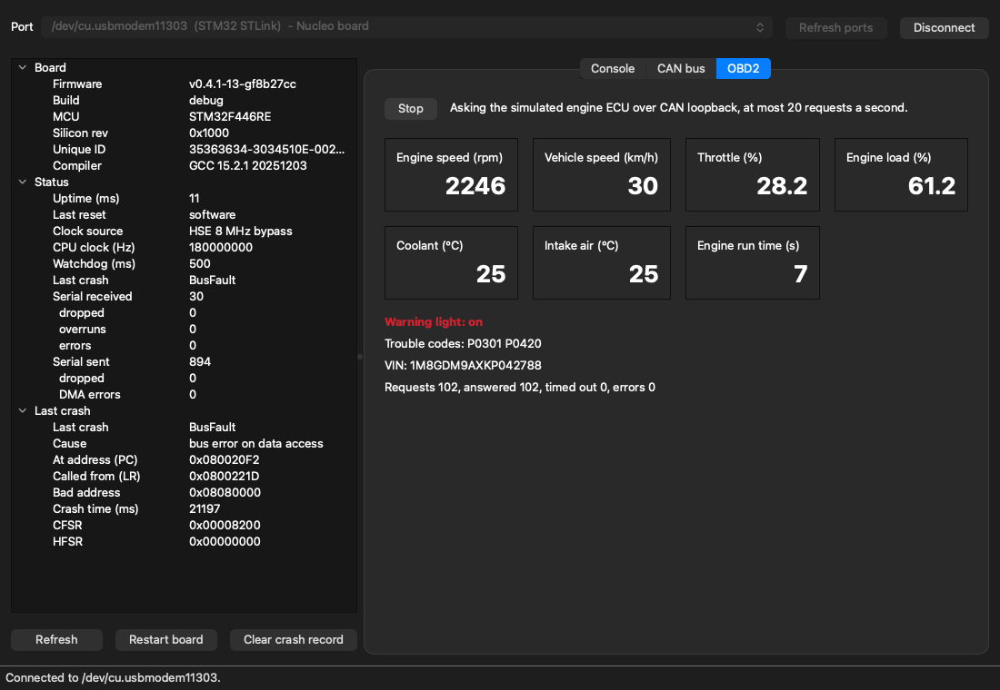

# Getting started

Part of the [project documentation](README.md).

There are three ways in, and each one builds on the one before. Stop whenever you've seen enough.

| Level | What you get | What you need | Time |
|---|---|---|---|
| [1. Try it, no hardware](#level-1-try-it-no-hardware) | The desktop app and command line, running against a built-in simulator | Python and Git | A few minutes, plus a large download |
| [2. A real board, no compiler](#level-2-a-real-board-no-compiler) | The firmware running on a real board, with ready-made files | Level 1, a NUCLEO-F446RE board and a USB cable | About 5 minutes |
| [3. Build from source](#level-3-build-from-source) | Your own firmware build, the tests and the debugger | Level 2, and a compiler toolchain | About 15 minutes |

This project doesn't connect to a car yet. Today the firmware only runs its CAN controller in
loopback, against a simulated engine computer. See [Connecting to a car](#connecting-to-a-car).

New to the project? [How it works](how-it-works.md) explains what you'll be looking at.

## Level 1: try it, no hardware

You need [Python](https://www.python.org/downloads/) 3.10 or newer, and
[Git](https://git-scm.com/).

```sh
git clone https://github.com/ka5j/obd2-sniffer.git
cd obd2-sniffer
python3 -m venv .venv
source .venv/bin/activate          # Windows: .venv\Scripts\activate
pip install -e "host[gui]"         # the desktop app's Qt library is a large download
obdsniff --port sim gui
```

The window opens with the simulator selected. Press **Connect**, open the **OBD2** tab, and press
**Start**.

**You should see** engine speed, vehicle speed and the other values fill in and change as the
simulated engine idles and then accelerates, along with a warning light, two trouble codes and a
VIN:



The **CAN bus** tab sends test frames and shows them arriving. The **Console** tab takes the board's
commands: try `help`.

The same simulator works from the command line, with no desktop app:

```sh
obdsniff --port sim info           # version and status
obdsniff --port sim obd watch      # live values; Ctrl-C stops
obdsniff --port sim shell          # type the board's commands; `exit` quits
```

In a new terminal, run `source .venv/bin/activate` again from the `obd2-sniffer` folder first. To
install only the command line, without the large download, use `pip install -e host`. Every command
is listed in [the laptop tool's guide](../host/README.md).

## Level 2: a real board, no compiler

You need the laptop tool from Level 1, and:

| Item | Notes |
|---|---|
| [NUCLEO-F446RE](https://www.st.com/en/evaluation-tools/nucleo-f446re.html) | ST's development board. Its programmer (ST-LINK) is built in, so nothing else is needed to load firmware |
| USB Mini-B cable | Must be a data cable; some cables only carry power. The board takes its power from it |

### Load the firmware

1. Open the [latest release](https://github.com/ka5j/obd2-sniffer/releases/latest) and download
   `obd2_sniffer-vX.Y.Z-debug.bin`. These files were built from the release's source by CI and
   checked on a board before publishing. The Debug build also has the `crash` test command; the
   `release` file is the optimised build, without it.
2. Plug the board in. The red **COM** LED next to the USB connector lights up, and a USB drive
   appears. It is called **NOD_F446RE** or **NODE_F446RE**, depending on the board's ST-LINK version.
3. Copy the `.bin` file onto that drive. The COM LED flickers while the board is programmed, the
   drive reconnects, and the firmware starts. If the drive then shows a `FAIL.TXT` file, the copy
   didn't work: read the file, then copy the `.bin` file again.

**You should see** the green **LD2** LED blink once a second. (`.hex` and `.elf` files are there too,
for flashing tools such as [STM32CubeProgrammer](https://www.st.com/en/development-tools/stm32cubeprog.html).)

### Use the matching laptop tool

The laptop tool and the firmware should come from the same release. From the `obd2-sniffer` folder,
with the release you downloaded (for example `v0.5.0`):

```sh
git checkout v0.5.0
```

Then use the same commands as Level 1, without `--port sim`. The tool finds the board by itself:

```sh
obdsniff info                      # firmware version and status, from the board
obdsniff gui                       # the board is selected: press Connect
obdsniff can test                  # send 10,000 test frames, check every one arrives
```

**You should see** `obdsniff info` report the release's version, `STM32F446RE` and `168000000` for the
CPU clock, and `can test` end with `Passed.`

Only one program can use the board at a time, so close the desktop app before running a command.

### Check the board properly

```sh
python3 scripts/board_check.py --crash
```

This takes a little over a minute, and restarts the board several times. **You should see** every
line start with `PASS`, ending with `18 checks: all passed.` (14 with the `release` file, which has
no `crash` command). What each check means, and the latest results: [testing.md](design/testing.md#checks-on-the-board).

### See the start-up report (optional)

The board prints a short report each time it starts, and you can read it with no laptop tool at all.
Open its serial port at 1,500,000 baud, then press the black **RESET** button:

| System | Port | Command |
|---|---|---|
| macOS | `/dev/cu.usbmodem*` | `screen /dev/cu.usbmodem* 1500000` (quit: Ctrl-A, then K, then Y) |
| Linux | `/dev/ttyACM0` | `screen /dev/ttyACM0 1500000` |
| Windows | `COMx`: see Device Manager, "STMicroelectronics STLink Virtual COM Port" | [PuTTY](https://www.putty.org/): Serial, the COM port, speed 1500000 |

```
========================================
 OBD2 CAN Sniffer  v0.5.0
----------------------------------------
 MCU      STM32F446RE  rev 0x....
 UID      ........-........-........
 Clock    HSE 8 MHz bypass
 SYSCLK   168 MHz
 PCLK1    42 MHz   PCLK2 84 MHz
 Reset    reset pin
========================================
!started
```

The silicon revision and unique ID differ from board to board. `!started` tells the laptop tool the
board is ready, and pressing the blue **USER** button prints `!button pressed`. The board's commands
are made for programs, so use the laptop tool to type them. Close the terminal before starting it.

## Level 3: build from source

### Install the tools

| Tool | Version | Why |
|---|---|---|
| [Arm GNU Toolchain](https://developer.arm.com/downloads/-/arm-gnu-toolchain-downloads) (`arm-none-eabi-gcc`) | Built and tested with 15.2.Rel1 | Compiler for the microcontroller |
| [CMake](https://cmake.org/download/) | 3.25 or newer | Build system |
| [Ninja](https://ninja-build.org/) | Any recent | Fast build tool that CMake drives |
| [OpenOCD](https://openocd.org/) | 0.12 (optional) | Flashing and debugging from the command line |

**macOS (Homebrew):**

```sh
brew install --cask gcc-arm-embedded
brew install cmake ninja open-ocd
```

Homebrew installs the newest toolchain release, which may be newer than the tested 15.2.Rel1. To
match exactly, use the macOS installer for 15.2.Rel1 from the Arm downloads page instead.

**Linux (Ubuntu / Debian):**

```sh
sudo apt update
sudo apt install cmake ninja-build openocd screen
```

For the compiler, download the **x86_64 Linux hosted, arm-none-eabi** archive from the
[Arm GNU Toolchain downloads](https://developer.arm.com/downloads/-/arm-gnu-toolchain-downloads),
extract it (for example to `/opt`), and add its `bin` folder to your `PATH`. Ubuntu's own
`gcc-arm-none-eabi` package is an older release and is not what this project is tested with.

To use the serial port without `sudo`, add yourself to the `dialout` group, then log out and back
in:

```sh
sudo usermod -aG dialout "$USER"
```

**Windows:** install the Arm GNU Toolchain (Windows installer, tick **Add path to environment
variable**), CMake (tick **Add CMake to the system PATH**), and put `ninja.exe` from the
[Ninja releases](https://github.com/ninja-build/ninja/releases) in a folder on your `PATH`. Run the
commands below from **Git Bash** or PowerShell.

The project is developed on macOS and continuously built on Linux. The Windows steps use the standard
installers but are not tested.

**Check the installation:**

```sh
arm-none-eabi-gcc --version
cmake --version
ninja --version
```

If the toolchain is installed but not on your `PATH`, point the build at it instead:

```sh
export ARM_TOOLCHAIN_DIR=/path/to/arm-gnu-toolchain/bin
```

### Get ST's driver libraries

The firmware uses ST's driver libraries (HAL and CMSIS), kept as separate repositories pinned to exact
versions. Levels 1 and 2 don't need them. From the `obd2-sniffer` folder:

```sh
git checkout develop               # the newest code, if you checked out a release in Level 2
git submodule update --init --recursive
```

### Build

```sh
cmake --workflow --preset firmware
```

This configures and builds in one step, and **you should see** it end with a memory report. The output
is in `build/firmware/firmware/`:

| File | Use |
|---|---|
| `obd2_sniffer.bin` | Raw image: drag-and-drop flashing, STM32CubeProgrammer |
| `obd2_sniffer.hex` | Intel HEX image for most flashing tools |
| `obd2_sniffer.elf` | Image with debug information, for OpenOCD and debuggers |
| `obd2_sniffer.map` | Linker map: where everything is placed in memory |

For the smaller, optimised build, use `cmake --workflow --preset firmware-release` (output in
`build/firmware-release/`).

### Load it

Copy `obd2_sniffer.bin` onto the board's USB drive, as in Level 2. Or, with OpenOCD:

```sh
cmake --build --preset firmware --target flash
```

This programs the board, verifies what was written, and restarts it.

### Run the tests

The hardware-independent code has unit tests that run on your computer, with no board:

```sh
cmake --workflow --preset host-tests
```

This builds the tests with memory and undefined-behaviour checkers and runs all of them. The laptop
tool's tests run with `cd host && pip install -e ".[dev]" && python -m pytest --cov`. Coverage
measurement and the MISRA C check are described in [testing.md](design/testing.md) and
[misra.md](design/misra.md).

### Debug

With VS Code, install the recommended extensions (**Cortex-Debug**, **CMake Tools**), then run
**Debug (OpenOCD, ST-LINK)** from the Run and Debug panel. It builds, flashes, and stops at the
start of `main()`, so you can step through the code and inspect variables and registers.

## Connecting to a car

Not yet. The firmware has no way to use a real CAN bus today: it only runs in loopback, where nothing
leaves the chip, and it hasn't been tried on a real bus or car. The design for the car connection is
in [hardware.md](design/hardware.md#connecting-to-a-car), and [safety.md](design/safety.md) covers the
risks and the order the tests will follow. Read both before connecting anything to a car.

## Troubleshooting

| Problem | Fix |
|---|---|
| `obdsniff: command not found` | The Python environment isn't active in this terminal. From the `obd2-sniffer` folder, run `source .venv/bin/activate` (Windows: `.venv\Scripts\activate`) |
| "PySide6" or "pip install" message from `obdsniff gui` | The desktop app wasn't installed: `pip install -e "host[gui]"` |
| `no board found` | Check the USB cable (many are power-only) and the red COM LED. To try without a board, add `--port sim` |
| `cannot open ... in use by another program` | Only one program can use the board. Close the desktop app, a serial terminal, or another `obdsniff` |
| No USB drive and no serial port | Try another USB cable and check the red COM LED. On older Windows versions, install ST's [ST-LINK driver (STSW-LINK009)](https://www.st.com/en/development-tools/stsw-link009.html) |
| Linux: "Permission denied" on `/dev/ttyACM0` | Add yourself to the `dialout` group ([Level 3](#install-the-tools)), then log out and in |
| Serial terminal shows nothing | Press RESET after connecting. Check the speed is 1500000 and that no other program has the port open |
| Garbled characters | Wrong speed: use 1500000, 8 data bits, no parity, 1 stop bit. Releases before v0.3.0 use 115200 |
| No start-up report, and the green LED blinks in a fast pattern | The board isn't receiving the 8 MHz clock from the ST-LINK (solder bridges changed, or a different board), so it stops rather than run with timing it can't trust. See [hardware.md](design/hardware.md#clock-configuration) |
| CMake: "ST HAL sources are missing" | The driver libraries weren't downloaded: `git submodule update --init --recursive` |
| `arm-none-eabi-gcc` not found | Install the toolchain and add its `bin` folder to `PATH`, or set `ARM_TOOLCHAIN_DIR` |
| OpenOCD can't find the ST-LINK | Close other programs using the board (STM32CubeIDE, another debug session). On Linux, make sure OpenOCD's udev rules are installed (the `openocd` package does this), then unplug and replug the board |
| OpenOCD or CubeProgrammer report old ST-LINK firmware | Update it with STM32CubeProgrammer (Firmware upgrade) or ST's [ST-LINK upgrade tool](https://www.st.com/en/development-tools/stsw-link007.html) |
