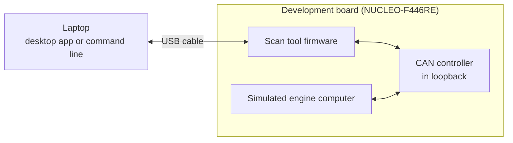
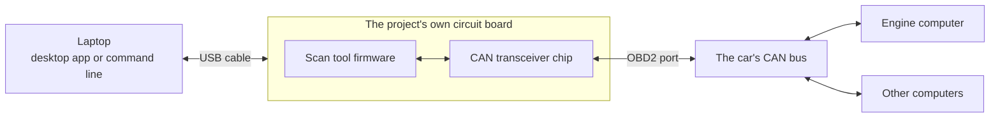
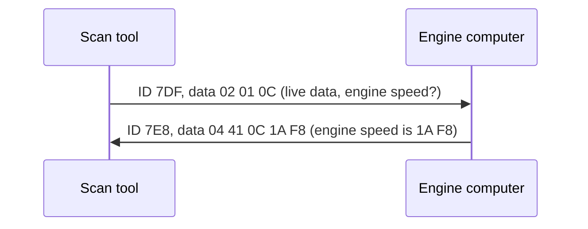
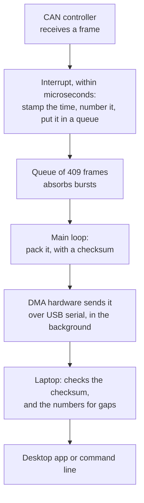
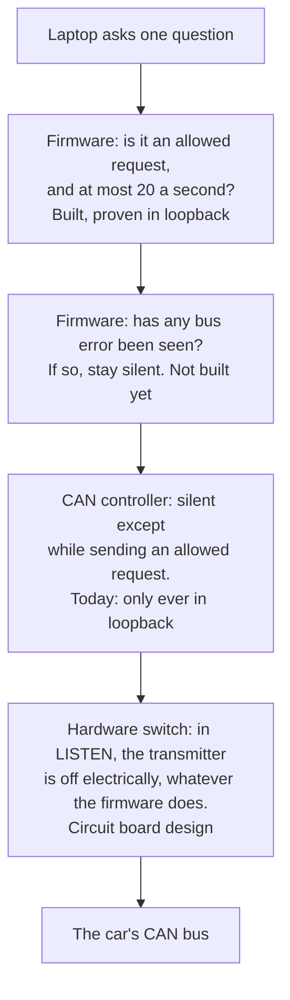

# How it works

This page explains the whole project from the beginning, for someone who knows nothing about car
electronics. It takes about 10 minutes. Each section links to the design document with the full
detail. [All the documents](README.md) are listed on one page.

## The problem: cars are networks

A modern car has dozens of small computers, called **ECUs** (electronic control units), running the
engine, brakes, airbags and dashboard. They constantly share information. The engine computer
announces its speed, and the dashboard shows it. Instead of running a separate wire for every value,
they all share one pair of wires: the **CAN bus**.

The law requires cars to offer a way in for diagnosing faults. That way in is the **OBD2 port**, a
16-pin socket under the dashboard, and it's the socket a mechanic's scan tool plugs into. Every car
sold in North America since 2008 speaks CAN on it.

This project is a scan tool built from the ground up. Plugged into that port, it does three things:

- **Listen:** record the messages on the car's network, each with a precise timestamp.
- **Ask:** request standard diagnostic data from the engine computer: engine speed, vehicle speed,
  temperatures, trouble codes and the vehicle identification number (VIN).
- **Show:** send it all to a laptop, for a desktop app or the command line to display.

And it must never disturb the car. Everything below follows from that.

## What exists today, and the goal

**Today**, everything runs on an off-the-shelf development board and a laptop. There is no car and
no wiring. The board's CAN controller runs in **loopback**, which means it receives its own messages
and nothing leaves the chip. So the board plays both parts: the diagnostic tool, and a simulated
engine computer that answers it.

This proves the firmware, the protocols and the laptop software, with real CAN hardware inside the
chip. It doesn't prove anything about a real bus or a real car: neither has been tried yet.

**The goal** is the project's own circuit board, plugged into the car. It is designed but not built.

The steps from one to the other are in the
[project status](../README.md#project-status), and the board itself in
[circuit-board.md](design/circuit-board.md).

If you have neither a board nor a car, you can still run all of the laptop software against a
simulator: [getting-started.md](getting-started.md).

## What travels on the wires

A CAN message is called a **frame**. It is short:

| Part | Size | Meaning |
|---|---|---|
| Identifier (ID) | 11 bits, or 29 in the extended form | What the message is about. It doubles as its priority: when two computers talk at once, the lower ID wins and the other waits |
| Length | 0 to 8 | How many data bytes follow |
| Data | Up to 8 bytes | The content |

Every computer on the bus sees every frame. That's why a tool that only listens can record them all
without anyone noticing.

## Asking a question

OBD2 defines standard questions and how to answer them. Here is a real exchange: the scan tool asks
for the engine speed, and the engine computer answers.

| Bytes | Meaning |
|---|---|
| `7DF` | The ID that means "to every engine-related computer" |
| `02` | 2 bytes of question follow |
| `01` `0C` | Service 01 (live data), parameter 0C (engine speed) |
| `7E8` | The ID the engine computer answers from |
| `04` | 4 bytes of answer follow |
| `41` `0C` | The reply to service 01 (0x01 + 0x40), about parameter 0C |
| `1A` `F8` | The value. The standard's formula gives (256 x 0x1A + 0xF8) / 4 = 1726 rpm |

An answer longer than a frame can carry, such as the 17-character VIN, is split over several frames
by a protocol called **ISO-TP**. The engine computer sends the first frame, the tool replies "go
ahead", and the rest follow.

Detail: [obd2.md](design/obd2.md).

## The path of a frame, from the wire to the screen

Frames can arrive every 238 microseconds on a busy bus, and none may be lost. So the work is split
between a very fast part that never waits, and a slower part that does the rest.

The numbers are how the project can say nothing was lost. Each frame is numbered the moment it
arrives, even if the board later has to drop it, so a missing number on the laptop always means a
lost frame. When a bus outruns the USB link, the board counts each dropped frame and the laptop sees
each one as a gap. Measured on the board, in loopback: 100,000 frames in a row at full load, none
lost.

The board's firmware has no operating system. A single main loop runs each task in turn, and no
task ever waits. A hardware **watchdog** restarts the board if the loop ever stalls, and if the
processor crashes, the board records where and why, restarts, and reports it.

Detail: [how the firmware fits together](design/architecture.md),
[can-capture.md](design/can-capture.md),
[fault-handling.md](design/fault-handling.md).

## The laptop and the board

The board speaks one small text protocol, made for programs. The laptop sends a command line, and
the board answers with `key=value` lines, then `OK` or `ERR`. Captured frames arrive as compact
binary packets between those lines. The board formats nothing for people: the laptop tool does all
the presenting.

The board also decides nothing about what to ask. The laptop works through a plan (the VIN first,
the trouble codes every 5 seconds, the live values in turn) and sends one `obd ask` at a time.

Detail: [protocol.md](protocol.md), [the laptop tool](../host/README.md).

## How it stays safe for the car

The device is a **read-only scanner**. It can ask for live data, stored trouble codes and the VIN,
and those questions change nothing in the car. Anything that could change something, such as clearing
trouble codes or resetting a computer, simply isn't built in.

No single safety check should be trusted alone, so several independent layers each stop a transmit:

The layers stop the device transmitting. They don't remove every risk: a wiring fault could still put
12 V on the network wires, for example. The remaining risks, and how each is handled, are in
[safety.md](design/safety.md).

## How it's checked

- **The core logic** is plain C with no hardware code, so it runs on a laptop, where it is unit-tested
  to 100% MC/DC coverage. That is the standard used for flight-control software: every condition in
  every decision must be shown to matter.
- **All C code** follows MISRA C:2012, the automotive industry's coding rules, with every exception
  written down.
- **Every change** is built, tested and analysed automatically before it can be merged, including a
  worked-out worst case for the firmware's stack.
- **The hardware behaviour** is checked on the real board by a script, before each release, on the
  exact files that get published.
- **What the device must do** is written down as numbered requirements, each with its test and its
  honest status today.

Detail: [testing.md](design/testing.md), [requirements.md](design/requirements.md),
[misra.md](design/misra.md), and the [live quality report](https://ka5j.github.io/obd2-sniffer/).

## Words used

| Term | Meaning |
|---|---|
| CAN bus | The two-wire network a car's computers share |
| ECU | Electronic control unit: one of the car's computers |
| OBD2 | On-Board Diagnostics: the standard port on a car, and the standard questions asked over it |
| Frame | One CAN message: an ID and up to 8 data bytes |
| Loopback | A CAN controller receiving its own frames, with nothing leaving the chip |
| Transceiver | The chip between a CAN controller and the bus wires |
| ISO-TP | The protocol that splits a long message over several CAN frames |
| VIN | Vehicle identification number: 17 characters, unique to each car |
| Trouble code | A fault an ECU has recorded, such as P0301 (cylinder 1 misfire) |
| Firmware | The program that runs on the microcontroller |
| Interrupt | The hardware pausing the main program to run a short handler, then resuming it |
| DMA | Direct memory access: hardware that moves data without the processor |
| Watchdog | A timer that restarts the chip unless the software regularly proves it is alive |
