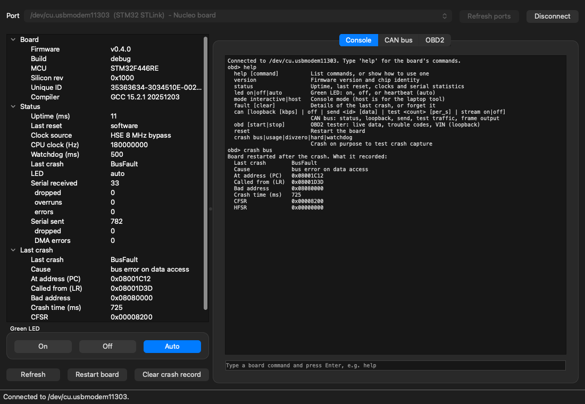
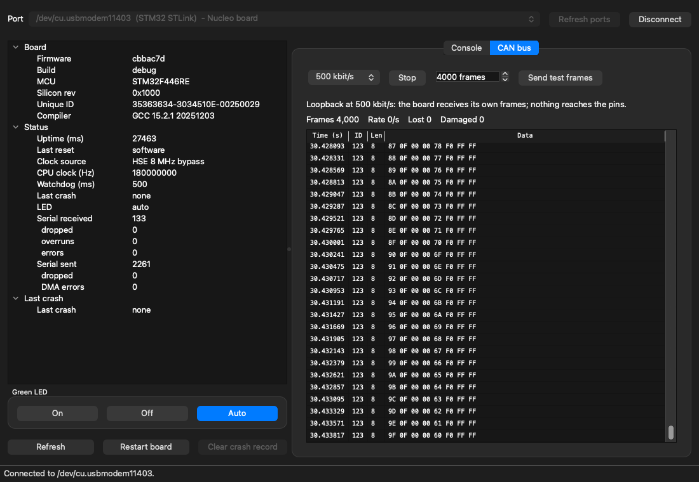
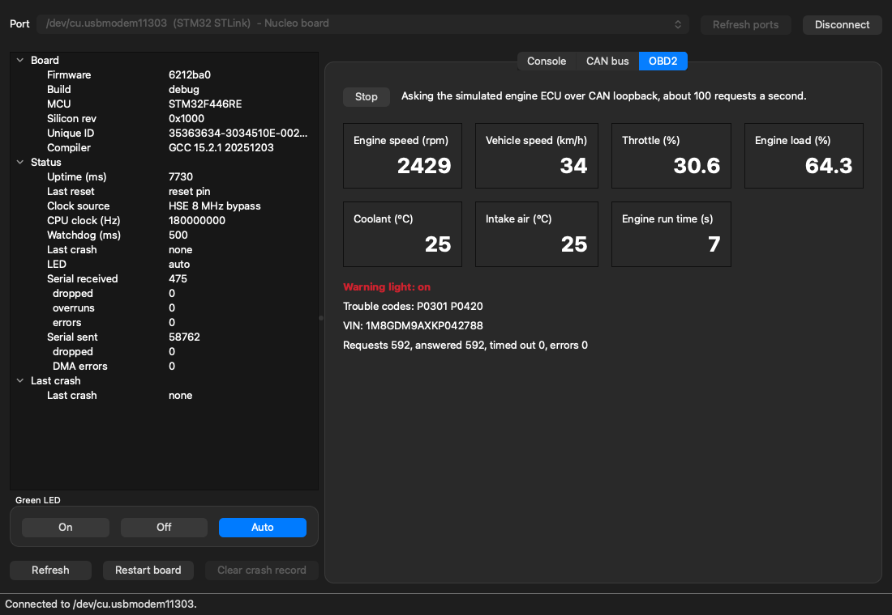

# obdsniff: laptop tool

`obdsniff` is the laptop side of the OBD2 CAN Sniffer. It connects to the board over USB and lets
you check its status, control it, watch events as they happen, and work with it interactively,
from the command line or from a desktop app. A built-in **simulator** (`--port sim`) behaves like
the real board, so everything can be tried without hardware.

## Install

Requires Python 3.10 or newer. From the repository root:

```sh
python3 -m venv .venv
source .venv/bin/activate          # Windows: .venv\Scripts\activate
pip install -e host
```

## Use

```sh
obdsniff ports                     # list serial ports; the Nucleo is marked
obdsniff info                      # firmware version and board status
obdsniff version                   # firmware version and chip identity only
obdsniff status                    # uptime, last reset, clocks, serial statistics
obdsniff led on                    # on | off | auto (heartbeat)
obdsniff fault                     # details of the last crash, if any (--clear forgets it)
obdsniff reset                     # restart the board and reconnect
obdsniff crash bus                 # debug firmware: crash on purpose, show what was recorded
obdsniff can loopback              # CAN in loopback: the board receives its own frames
obdsniff can test                  # send 10,000 test frames and check that every one arrives
obdsniff can send 7DF 0201050000000000   # one frame (hex, as in Linux's cansend)
obdsniff can stream off            # stop sending frames to the laptop (the board still counts them)
obdsniff can                       # CAN status: frames received, dropped, error counters
obdsniff can off
obdsniff obd watch                 # OBD2 live data from the simulated ECU (starts loopback, Ctrl-C stops)
obdsniff obd                       # the tester's latest answers once: values, trouble codes, VIN
obdsniff obd start                 # start or stop the board's OBD2 tester (needs loopback)
obdsniff monitor                   # print CAN frames and events as they happen (turns streaming on)
obdsniff monitor --log trace.log   # ...and save the frames in candump format
obdsniff shell                     # interactive session
obdsniff gui                       # desktop app (see below)
```

The board is found automatically. Use `--port /dev/tty.usbmodem1103` (or `COM5` on Windows) to
choose one, or `--port sim` for the simulator. Add `--json` for machine-readable output:

```sh
$ obdsniff --port sim --json status
{
  "uptime_ms": "1534",
  "reset_cause": "power-on",
  ...
}
```

Exit codes: `0` success, `1` the board rejected the command (or `can test` found a problem),
`2` no connection or invalid arguments.

Only one program can use the board's port at a time. A second one (another `obdsniff`, or a
serial terminal) gets a clear "in use" error, instead of the two silently splitting the board's
output between them.

### CAN

The board's CAN controller has a **loopback** mode: frames it sends are received back
internally and nothing reaches its pins. Everything from capture to display can be tested with
the board alone:

```
$ obdsniff can test --count 50000
CAN loopback test: 50000 frames at 500 kbit/s, as fast as the bus allows
  Received   50000 of 50000, none lost
  Content    all correct, in order
  Damaged    0 packets
  Bus rate   4,212 frames/s (board timestamps)
  Spacing    234 / 238 / 252 us (min / median / max)
Passed.
```

Each test frame carries its own number, so `can test` checks every frame arrived, in order and
undamaged. `monitor` shows frames as the board prints them:

```
  1277.564848  123       [8]  24 00 00 00 DB FF FF FF
  1277.565850  123       [8]  25 00 00 00 DA FF FF FF
```

`--log FILE` also writes them in the candump format of Linux's can-utils, which tools such as
SavvyCAN can open. With `--json`, each frame is one JSON object per line. When `monitor` stops it
reports how many frames arrived and how many were lost, from the gaps in the board's capture
numbers.

When it finishes, the tool switches the board back to interactive mode, so a serial terminal
opened afterwards works as usual.

### Interactive shell

```
$ obdsniff --port sim shell
Connected. Type board commands (try 'help'); 'exit' or Ctrl-D quits.
obd> status
  Uptime (ms)       5210
  Last reset        power-on
  ...
obd> crash bus
Board restarted after the crash. What it recorded:
  Last crash        BusFault
  Cause             bus error on data access
  ...
```

Commands are passed to the board. The shell keeps the board in host mode underneath, formats the
replies, shows events as they arrive, and reconnects automatically after `reset` or `crash`.

## Desktop app

```sh
pip install -e "host[gui]"         # adds PySide6 (Qt)
obdsniff gui                       # or: obdsniff --port sim gui
```



Pick the port (the Nucleo is found and selected automatically; the simulator is always listed)
and press **Connect**. The left side shows the board's version, status and last crash, and has
buttons for the LED, restarting the board and clearing the crash record. The console on the right
takes the same commands as the shell, and events such as button presses appear there as they
happen.

The **CAN bus** tab starts and stops loopback at a chosen bit rate, sends test frames, and
shows the newest frames as they arrive, with counts of frames received, frames per second, frames
lost and damaged packets:



The **OBD2** tab starts the board's OBD2 tester (and CAN loopback, if it is off) and shows what it
reads from the simulated engine ECU as it changes: engine speed, vehicle speed, throttle, engine
load, coolant and intake temperature and run time, the warning light, stored trouble codes, the
VIN, and the request counters. The tab also follows a tester started from the console.



The connection to the board runs on its own thread, so the window stays responsive even while the
board restarts or thousands of frames a second stream in. When the app closes, the board is
handed back in interactive mode.

## As a library

```python
from obdsniff import open_device

with open_device("sim") as board:  # or a port path, or None to find the board
    print(board.status()["uptime_ms"])
    board.set_led("on")
    print(board.poll_events(timeout=1.0))  # e.g. ['button pressed']
```

## Development

```sh
pip install -e "host[dev]"
cd host
ruff check . ../scripts && ruff format --check . ../scripts   # the repo's scripts too
python -m pytest --cov            # 100% line and branch coverage is required
```

| Module | Role |
|---|---|
| `device.py` | Protocol client: reliable connect, commands, `key=value` parsing, events, restarts |
| `transport.py` | Byte transport: the serial port (pyserial) |
| `simulator.py` | Software model of the board's console, used by `--port sim` and the tests |
| `ports.py` | Finds the board by its ST-LINK USB IDs |
| `packets.py` | Binary frame packets: COBS, CRC, decoding; separates them from the console text |
| `cantest.py` | `can test`: runs a test series and checks every frame |
| `sim_can.py` | The simulator's CAN controller (loopback, test traffic) |
| `sim_obd.py` | The simulator's OBD2 side: the simulated engine ECU, the board's tester and the `obd` command, modelled on the C code |
| `cli.py`, `shell.py`, `output.py` | Command line, interactive shell, formatting |
| `gui/window.py` | Desktop app window: displays results, turns clicks into requests |
| `gui/worker.py` | Desktop app's board connection, run on its own thread; talks to the window only through Qt signals |
| `gui/can_panel.py` | The app's CAN tab: loopback, test traffic, live frame table and counters |
| `gui/obd_panel.py` | The app's OBD2 tab: start the board's tester, live values, warning light, trouble codes, VIN |

The serial protocol is described in [docs/protocol.md](../docs/protocol.md).
